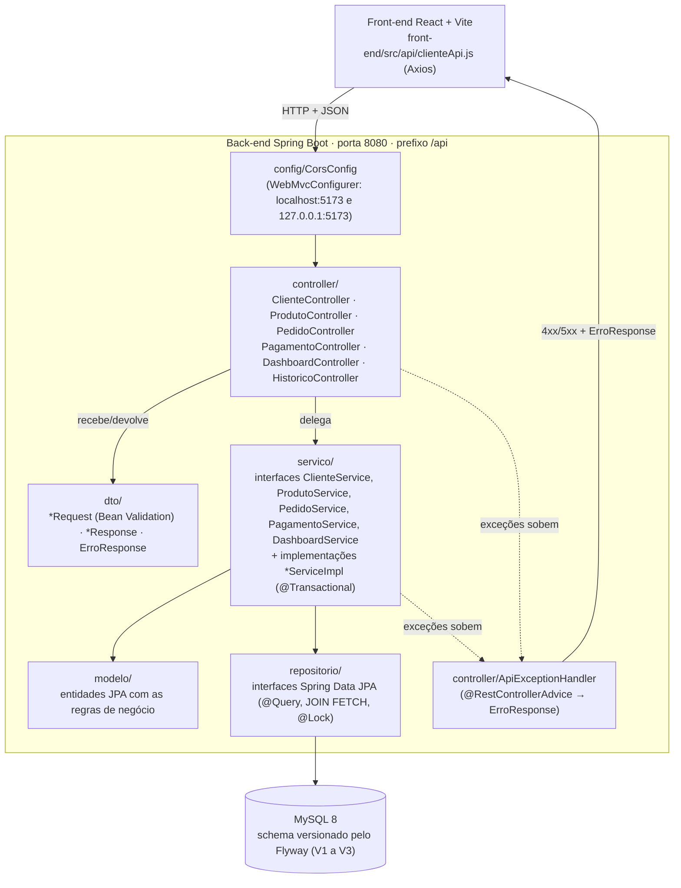
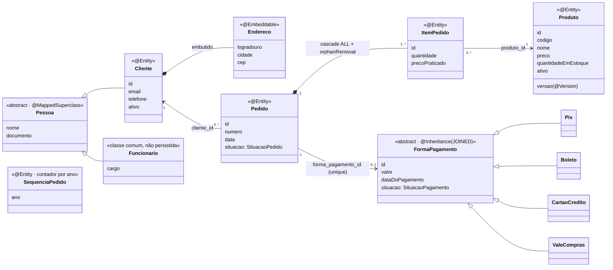
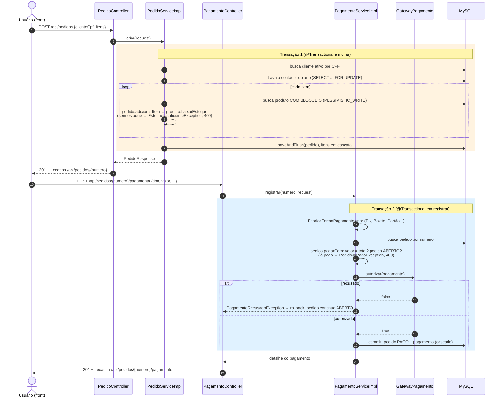
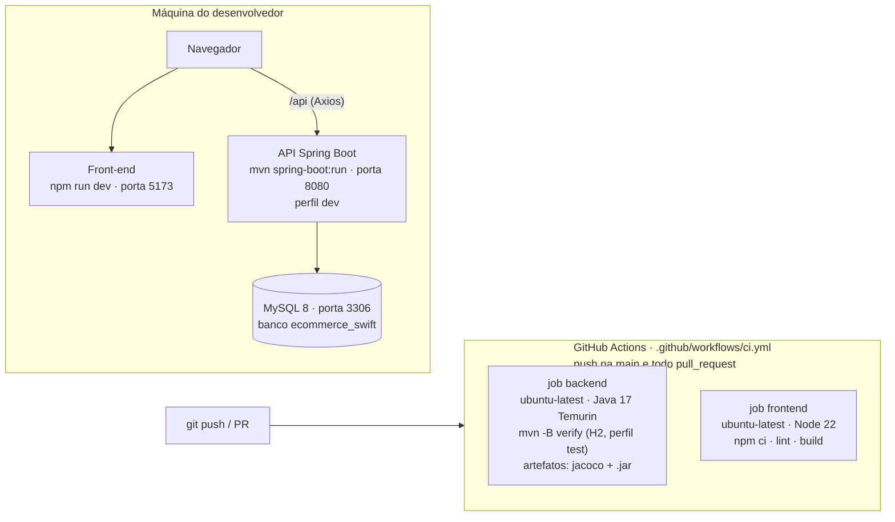

# Arquitetura e execução

Diagramas do Sistema de Gestão de Pedidos (squad Swift). Todos em Mermaid, que o GitHub desenha direto nesta página. Os nomes de classes, rotas e arquivos são os do código atual.

## 1. Arquitetura em camadas

* Os controllers só traduzem HTTP: recebem o DTO validado (`@Valid`), chamam o serviço e devolvem DTO. Não acessam repositório nem têm `try/catch`.
* As regras ficam no domínio (ex.: `Pedido.pagarCom`, `Produto.baixarEstoque`) e na orquestração dos serviços.
* Toda exceção vira resposta no `ApiExceptionHandler`, com o corpo `{ status, erro, mensagem, caminho, campos }`.

## 2. Modelo de domínio

Notas que vêm do código:

* `Pessoa` é `@MappedSuperclass`: não tem tabela própria, e os campos dela vão para a tabela `cliente`. `Funcionario` herda de `Pessoa`, mas **não** é entidade (não tem tabela nem rota).
* `FormaPagamento` usa `InheritanceType.JOINED`: uma tabela com os campos comuns e uma tabela por subclasse.
* Um pedido nasce com pelo menos um item (`POST /api/pedidos` com `itens` vazio → 400). Depois de criado, o item pode ser removido enquanto o pedido estiver `ABERTO`.
* O pagamento é 0..1: o pedido nasce sem pagamento e recebe no máximo um (`forma_pagamento_id` é `unique`).
* `SequenciaPedido` não se liga às outras entidades por chave: é o contador que gera o `numero` do pedido (migration V3).

## 3. Sequência do fluxo principal

O estoque **baixa na criação do pedido**, e não no pagamento. São duas transações separadas.

* Se qualquer item falhar na transação 1, nada é gravado: nem estoque, nem pedido, nem o número do contador.
* Cancelar (`PATCH /api/pedidos/{numero}` com `{"situacao":"CANCELADO"}`) devolve o estoque e, se o pedido estava pago, estorna o pagamento.

## 4. Execução e CI

* No CI não há MySQL nem segredos: os testes usam o perfil `test`, com H2 em memória (`MODE=MySQL`) e as mesmas migrations do Flyway.
* **Não existe deploy em nuvem.** O projeto roda só localmente. O pipeline faz integração contínua (testes e build), mas não publica a aplicação em nenhum servidor. Os artefatos ficam só para download na execução do Actions.

## Próximos passos (proposta, não implementada)

Uma opção viável e gratuita para publicar a aplicação:

1. **Front-end:** publicar o `front-end/dist/` no GitHub Pages, por um job a mais no workflow que rode só na `main`. Antes, a `baseURL` fixa (`http://localhost:8080/api` em `clienteApi.js`) teria de virar uma variável de build (`import.meta.env.VITE_API_URL`).
2. **Back-end:** gerar uma imagem Docker do `.jar` e publicar num serviço com plano gratuito para contêineres (ex.: Render), com `DB_URL`, `DB_USERNAME` e `DB_PASSWORD` como variáveis de ambiente do serviço. Nunca no repositório.
3. **Banco:** um MySQL gerenciado com plano gratuito (ex.: Aiven). As migrations do Flyway criam o schema na primeira subida.
4. **CORS:** incluir a origem publicada do front no `CorsConfig`.

Limites e condições dos planos gratuitos mudam com frequência. Confira antes de escolher. Planos gratuitos costumam "dormir" sem uso, então a primeira requisição pode demorar.
